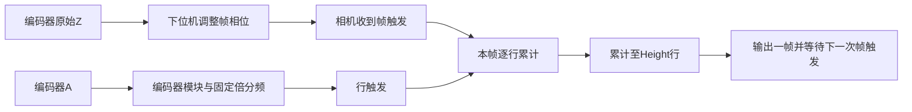

# 相机触发与必要参数整理

最后更新：2026-11-13

状态：已在7.2.0实现。当前操作、schema2迁移、实际读回和写入顺序见[13-相机参数](13-相机参数.md)。下文保留需求收敛依据；现场相机及下位机尚未验证。

## 依据与边界

- 用户原需求：`C:/Users/ROG/Desktop/机器视觉参数计算及设置工具-需求.md`，重点为第2节、第4.1节及第5节的参考相机节点。
- 用户最新澄清：一帧对应一个产品；下位机调整帧触发相位；帧触发后用行触发逐行取图，采满Height结束这一帧。
- 当前核对的配置值来自需求文档对`MV-CL042-91GM_DA8025751.mfs`的摘录。尚未取得原始MFS，不能把摘录当作该文件所有节点的完整审计结果。
- 海康[GigE线扫相机用户手册](https://www.hikrobotics.com/en2/Hikrobotics/Machine%20Vision/01%20Product/%E5%B7%A5%E4%B8%9A%E7%BA%BF%E9%98%B5%E7%9B%B8%E6%9C%BA/%E7%94%A8%E6%88%B7%E6%89%8B%E5%86%8C/UD24388B_GigE%20Line%20Scan%20Camera%20User%20Manual_V3.4.32_20210621.pdf)第7.2、7.4、7.5.5、7.6节，用于核对Height成帧、帧/行触发、触发频率、单次触发帧数及延时/缓存行为。具体可写节点及当前值仍以现场设备读回为准。
- 下位机契约见项目根目录的[Z相延迟行为](../../docs/02-Z相延迟行为.md)：按A上升沿计数调整Z输出相位，不把它等同于固定毫秒延迟。该文档是设计/模型契约，不能作为现场板已实现或已连接的证据。
- 本机[MVS节点说明](C:/ProgramData/MVS/Local/Features.xml)及[MV-CL042-91GM虚拟设备XML](C:/ProgramData/MVS/VirtualCamera/MV-CL042-91GM/MV-CL042-91GM.xml)补充核对了节点名称和语义。虚拟设备描述中的枚举与能力不代表现场相机当前值，也不能代替原始MFS。

## 采集过程



这套机制不要求操作员输入产品间距。帧起点由帧触发位置决定，帧长度由Height决定；产品前后的背景包含在这一帧内。相机不会识别产品边缘后自行停拍。

需要区分三个行数：

| 量 | 含义 | 决定因素 |
|---|---|---|
| 产品实际占用行数 | 产品前缘至后缘在图中的行数 | 产品长度与实际纵向采样精度 |
| 整帧Height | 这一张图实际采集的总行数 | 产品占用行数＋前后背景＋设备步长 |
| 相邻帧触发间的行触发总数 | 两次帧开始事件之间产生多少行节拍 | 编码器、固定倍分频及帧触发关系 |

三者不能统称为“每产品行数”。尤其不能直接要求Height等于编码器每圈计数，也不能把编码器每圈计数全都认作产品在图中的像素高度。

原需求第4.1节的“N”和“Height≥N”应按这三个量重新命名后理解。例如，只有确认同一工位为2000个有效A计数/圈、变频1/3/1、一圈一个帧触发时，周期总行触发数才约为6000；参考图高3200表示每帧采3200行，并不要求把图高改为6000。此例仅说明数量口径，不是已测得该现场的参数。

## 相位与前后留白

下位机负责把采集窗口放到正确位置；Height负责窗口长度。调试目标是让实际开始曝光的位置早于目标产品前缘到达的位置，留下头部背景，再在产品后缘后留出尾部背景，给信号传播和响应时间留出空间。

相位值增大对应画面向哪边移动，应按现场Z参考位置和当前产品确认，不能承诺“增加延迟必然增加头部留白”。固定相位通常平移整幅取图范围，不改变纵向像素精度，也不改变稳定运行时相邻帧触发的周期。

因此，主界面可用“纵向总留白”决定图高；头部/尾部的实际分配通过下位机相位调节并看图确认。只在软件中填写“上方留白”而未控制相位，不能保证产品在对应行才出现。相机自身TriggerDelay需读回核对，避免与下位机延迟不明叠加；不能把下位机参数写进相机节点。

## 真正需要的操作参数

### 日常操作区

| 项目 | 用途 | 建议操作 |
|---|---|---|
| 工位/目标相机 | 确定相机和对应的成像/接线模板 | 选择一次；连接后按型号及序列号核对 |
| 产品宽度、长度 | 计算产品覆盖范围 | 换产品时填写 |
| 画面留边 | 横向留边决定Width，纵向总留白决定Height | 支持自动计算后微调；不填写产品间距 |
| 曝光时间 | 亮度及运动拖影 | 常用可调项 |
| 增益 | 亮度补偿 | 显示现场需要的Gain；DigitalShift等放高级区 |
| HB压缩 | 与既有采集链一致的压缩模式 | 模板默认值，可按设备能力调整 |
| 相机名称 | DeviceUserID | 选配，通常安装/换相机时修改 |

WD、焦距、传感器像元、P/R、固定倍分频和接线不是每换一个产品就重新填的内容，保存到工位模板。最大产能也作为工位能力校核值保存，需要评估新速度时再展开修改。

### 工位建档时填写或标定

| 项目 | 作用 | 来源 |
|---|---|---|
| X精度 | mm/px，用于横向覆盖计算 | 已标定精度；或实测全幅视野/传感器宽度；或WD＋焦距＋物理像元尺寸估算，三选一 |
| Y精度（线扫） | mm/行，用于产品高度与纵向留白换算 | 用已知长度产品在原始采集图中的占用行数标定，或输入已验证精度 |
| 编码器P/R与实际计数口径 | 估算/核对外部行触发节奏 | 编码器及接线资料；相机MFS不能告诉软件外部编码器的真实P/R |
| 固定PreDivider/Multiplier/PostDivider | 保持现场既定采样链 | 参考配置/设备读回，例1/3/1；不自动改来凑Height |
| 每产品帧触发与编码器圈数的关系 | 从产能推算频率 | 本工位约定每产品/每圈一个帧触发，其他工位不得照搬 |
| 预计最大产能 | 核对触发响应、曝光及传输能力 | 工位能力要求，不用于决定产品在画面中的起点 |
| 帧/A相输入及输出接线 | 确定输入输出Line、电气格式和极性 | 接线模板＋设备能力核对 |
| 下位机相位通道及当前相位 | 定位本工位产品在图中的前后位置 | 下位机设置与现场图像；独立于相机SDK写入 |

X和Y不需要操作员每天分别维护。Y用一次性标定保存在工位模板；拍到的产品长度为L毫米、占h行，则Y精度=L/h。标定须使用没有缩放/重采样的原始采集图。若还没有Y标定，可先按方形像素dy=dx规划Height，但应标明“规划值”，不能将其作为编码器实际采样精度已验证的结论。只修改Height不会修正纵向拉伸。

### 自动读回或模板设置的相机项

以下项目需要存在于正确配置中，但不应铺满操作界面。

| 配置组 | 本工位口径/参考摘录 | 软件处理 |
|---|---|---|
| 相机能力 | 型号、序列号、Width/Height范围和步长、像素格式 | 连接后读回，避免重复填写传感器尺寸 |
| 采集与一触发一帧 | AcquisitionMode=Continuous；使用FrameBurstStart时AcquisitionBurstFrameCount=1 | 设备支持时明确设置并读回；不能把持续等待多次触发误设成只采一次的SingleFrame |
| 帧触发 | FrameBurstStart、On、Line3、RisingEdge | 模板设置，允许接线模板变更 |
| 行触发 | LineStart、On、FrequencyConverter、FallingEdge | 与帧触发同时配置 |
| 编码器/变频器 | A=Line1、B=NA、AnyDirection、IgnoreDirection；输入EncoderModuleOut；1/3/1 | 采用本工位模板，不因图高变化自动修改 |
| ROI | Width=3296、OffsetX=500、Height=3200为参考值 | 根据新工位计算并按设备步长校验；不把这些数值当通用默认 |
| 成像基础 | Mono8、ReverseX=0、TDIMode=Line_1为参考摘录 | 模板设置并读回；曝光模式及自动曝光/增益状态要一并核对 |
| 输入IO | A输入Differential/300ns，帧输入Differential/1000ns | 模板设置，不让普通操作员重复填底层节点 |
| 输出IO | Line0曝光输出；Line4参考为SoftTriggerActive/25000μs | 按真实用途保留/启用，不能认定参考的每路输出都适用所有工位 |
| 行频控制 | 摘录AcquisitionLineRate=30000、Enable=0 | 显示外部行频及相机能力；不把未启用的30000误当有效触发节拍或强制上限 |
| 额外触发状态 | 相机TriggerDelay及LineDelayEnable、帧/行触发缓存、帧超时及不完整帧处理 | 原摘录不全；按选择器上下文读回延时数值及时间/按行延时模式。不能保留未知状态后就承诺任何停转/忙帧情形都只输出完整产品 |
| 用户集 | 保存UserSet1并设为默认 | 固定写入/读回流程 |
| 网络 | 包长、包间隔、心跳 | 保持现场网络配置；仅在传输诊断时展开 |

具体SDK节点名称及型号支持性以现场GenICam描述为准。传感器物理像元尺寸应来自型号资料或明确的物理尺寸节点，不能把通常表示位深的PixelSize拿来当作μm。

同型号虚拟XML明确提供只读TriggerLineRate（滤波后外部输入行频）、ResultingTriggerLineRate（经过变频器后的触发行频），以及当前ROI/曝光/带宽下的ResultingLineRate能力值。AcquisitionLineRateEnable说明为“使能手动控制行频”。这些信息支持把实际触发频率、设备允许频率和手动设置值分开核对。运行读回仍需检查节点是否可用。FrameTimeoutTime在该XML的描述与显示名称中存在μs/ms冲突，不能猜单位后自动写入。

### 面阵范围

面阵沿用工位选择、光学精度/标定、产品覆盖范围、曝光/增益、帧触发、IO和用户集流程。面阵没有逐行外部触发链，不引入编码器P/R、倍分频和线扫Y行距标定；ROI高度由传感器Y方向视野计算。不要将本页线扫的Height计行成帧机制套用于面阵采集时序。

## 计算输出应留下什么

```text
Width = 向上对齐[(产品宽度 + 左右总留边) / dx]
产品行数 = ceil(产品长度 / dy)
Height = 向上对齐[产品行数 + 前后背景总行数]
OffsetX = 按设备允许范围居中或手动设置
```

主结果只显示整图Width×Height、产品预计占用行数、预留背景行数与精度。下位机相位显示/调节属于单独功能，不宣称相机页已自动控制该板。

行频检查放在能力/设备状态中。已知产品帧触发与编码器圈数关系时：

```text
C = P/R × 相机实际计数倍率 × 每产品编码器转数
    × Multiplier / (PreDivider × PostDivider)
稳定匀速时预计外部行频 = 最大产能 / 60 × C
平均有效图像行输出 = 最大产能 / 60 × Height
```

这两个频率用途不同；采完一张图后存在等待下一帧的时间时，不能拿平均有效图像行输出替代采集期间的行触发频率。变速或周期内运动不均匀时，周期平均频率不能代替峰值；曝光与相机能力按最高实际行频/最短触发间隔核对。优先核对相机提供的输入触发频率和倍分频后触发频率；不支持或尚未运行时，不把0读数当现场最高频率。

相邻帧是否来得及拍完，应后台核对有效采集时间、帧触发忙/缓存状态和实际丢帧计数，不需要增加产品间距输入。若已核实C确实是两次帧触发间可用的行数，Height超过C仍需要核对忙帧处理；相位平移不会凭空增加采集时间。不能从“每张只拍一个产品”推出任意图高都不会丢帧。

## 7.2.0已落实的变更与现场边界

1. 删除“产品节距”作为新模式的必填项；旧配置字段需要显式迁移，不静默换含义。
2. 不再用产品节距除以每圈计数作为唯一Y精度来源；增加工位Y标定/已知精度和明确标注的方形像素规划口径。
3. 将产品占用行数、整帧Height及相邻帧间总行触发数分别命名和显示。
4. 留白先体现为总取图高度，前后位置由板相位与实际图像确认；不将UI框里的数值当作已执行的相位动作。
5. 补充采集模式、单次触发帧数、曝光模式及已有触发延时/超时/缓存的读回和模板核对。原参考摘录没有的字段不能冒充已从MFS读到。
6. Enable=0时不再以AcquisitionLineRate数值判定当前真实行周期；设备能力判断与外部触发频率判断分别处理。
7. 常用参数置于主界面；光学建档、编码器、接线、频率/传输诊断收进工位模板或高级区。

7.2已修改并测试程序；没有写实体相机、下位机或用户原需求文件。真实触发与成像仍须在现场验证。
