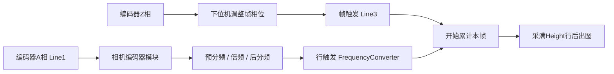

# 相机参数、倍分频与工位调试经验总结

最后更新：2026-11-14

适用版本：VT STUDIO 7.12.0。面向本项目常用海康相机、编码器和下位机帧相位控制方式。型号表是工具内置参考值，接线表是本项目约定；设备能力、实际走料和成像效果仍须现场核对。

## 1. 先确定采集过程

线扫一帧只采一个产品。下位机给出帧触发后，相机接受行触发，累计到设定的Height行就结束这一帧。相机不会识别产品尾部后自行停拍，也不需要为了决定图高再填写产品间距。



面阵只有帧触发，没有线扫的行触发和编码器倍分频计算。工具按相机类型显示相应参数。

## 2. 常用相机和固定镜头

| 相机 | 类型 | 工具内置分辨率 | 像元 | 本项目固定镜头 | 焦距 |
|---|---|---|---|---|---|
| MV-CL024-91GM / 91GC | 2K线扫，黑白 / 彩色 | 横向2048px | 7μm | MVL-KF1228M-12MP | 12mm |
| MV-CL042-91GM / 91GC | 4K线扫，黑白 / 彩色 | 横向4096px | 7μm | MVL-AF2524M-M42 | 25mm |
| MV-CS050-60GM V5 / 60GC V5 | 500万面阵，黑白 / 彩色 | 2448×2048px | 3.45μm | MVL-HF0628M-6MPE | 6mm |

黑白和彩色共用对应固定镜头。线扫传感器原生行数不能当作最终图像Height。彩色相机的Bayer排列和实际PixelFormat以设备为准，不只根据型号中的GC猜测。

## 3. 光学参数怎么计算

先输入材料宽W、长L，以及横向、纵向总余量百分比Yx、Yy：

```text
目标视野宽 Fx = W × (1 + Yx/100)
目标视野长 Fy = L × (1 + Yy/100)
线扫横向精度 dx = Fx / 横向像素数N       单位：mm/px
```

横向10%是整幅总余量，不是左右各10%。目标视野是需要覆盖的物理尺寸，和图高取整后的实际覆盖尺寸分别显示。

快速估算使用像元p(mm)、焦距f(mm)：

```text
工作距离 WD ≈ dx × f / p
已知距离时 dx ≈ p × WD / f，Fx = N × dx
横向总余量 = 100 × (Fx/W − 1)
```

专业近轴模型使用前主平面偏移h：

```text
物距 u = WD + h
dx = p × (u − f) / f
WD = f × (1 + dx/p) − h
```

这两种模型不能混着用。主平面未知时填0仍只是估算，不能把法兰后焦当作主平面偏移。精确尺寸应通过未缩放原图中的已知实物宽度标定，之后再核对畸变、边缘和对焦。

例如200mm材料、横向10%、2048px、7μm、12mm：Fx=220mm，dx=0.107421875mm/px；快速模型WD约184.152mm，零偏移薄透镜模型约196.152mm。

面阵为了同时装下两个方向，材料规划取dx=dy=max(Fx/Nx,Fy/Ny)，不能分别拉伸两个方向满足画幅。

## 4. 纵向采样必须有走料依据

知道材料长度和目标像素高度，还不能直接决定倍分频。必须知道同一帧周期实际走料S，或等价的每毫米有效输入计数。

本工具只要求测量S，其余由已有编码器参数推算：

```text
B = P/R × 有效计数倍率 × 每帧间隔编码器圈数
k = B / S                            每毫米有效输入计数
材料占周期比例 = L / S
材料通过期间的输入计数 = k × L
目标纵向精度 dy目标 = dx
目标总变频比 G目标 = 1 / (k × dy目标) = S / (B × dy目标)
```

P/R通常按编码器标称A相周期数理解，是否计入双沿或其他计数倍率要核对实际输入链。不要因为设置了某个边沿就擅自再乘2或4；统计倍率也不会替你修改硬件计数模式。

S必须对应“每帧间隔圈数”所表示的同一周期。编码器一圈一个帧周期时，测量一圈走料即可；有减速比或多圈一帧时一起计入。计数和走料成比例是计算前提，打滑需要通过实物原图复核。

## 5. 三项限制在1～5，允许适度近似

```text
G实际 = Multiplier / (PreDivider × PostDivider)
C = B × G实际                        相邻帧周期总行触发数
dy实际 = S / C
Y采样误差 = 100 × (dy实际/dy目标 − 1)
```

本项目规定预分频、倍频、后分频分别只能选1～5。自动计算在这个范围和设备实际min/max/inc的交集中搜索，优先减小纵向精度误差，再优先简单因子。手动输入同样受限；设备允许较大数值也不扩大本项目范围。

新建工位默认Y允许误差为±15%，专业标定中可以调整；导入已有配置保留原来的明确容差。近似后必须按实际dy重新计算材料像素和图高，不能仍把目标行数当成实际行数。是否接受该误差由产品尺寸要求决定；严格方形像素选项也会独立参与校验。

“三项不超过5”是本项目的简化配置约束，不等于已验证所有设备的运算负荷。设备是否能稳定采集还要看输出行频、曝光、带宽及实际触发情况。

### 例：材料只占周期的2/3

已知材料60mm、周期走料90mm、周期输入1000有效计数、目标0.02mm/行：

| 项目 | 结果 |
|---|---|
| 输入计数密度 | 1000/90≈11.111计数/mm |
| 材料通过期间输入计数 | 约666.667 |
| 材料目标行数 | 3000 |
| 周期目标行数 | 4500，不能直接拿3000作为周期行数 |
| 理论变频比 | 4.5 |
| 本项目1～5范围内建议 | 预分1、倍频5、后分1，总比5 |
| 实际周期行数 | 5000 |
| 实际dy / 相对目标误差 | 0.018mm/行 / −10% |
| 材料实际规划行数 | ceil(60/0.018)=3334 |

理论上1/9/2可以准确得到4.5，但已超出本项目的因子上限，不再推荐。如果工位不能接受−10%，应收紧容差，程序会阻止写入，而不是绕过上限凑大因子。

## 6. 图高、材料行数、周期行数分开看

| 量 | 计算 / 含义 |
|---|---|
| 材料像素 | ceil(W/dx) × ceil(L/dy实际)，不含留白 |
| 目标视野所需行数 | ceil(Fy/dy实际) |
| 本帧Height | 所需行数向上按图高取整步长及设备步长对齐，也可手动设置 |
| 图内背景行数 | Height减材料行数 |
| 周期总行触发数C | 整个周期产生的行触发，含本帧以外的部分 |
| 周期剩余空档 | floor(C)−Height |

必须同时满足Height能覆盖目标视野、周期空档不小于设置值。图高不够先检查实际dy和余量；空档不够则检查走料周期、留白和取整。不能只为让Height放得下而增加倍频，因为这样会改变纵向尺寸。

200×400mm、目标220×408mm的例子，若实测S=429.6875mm、周期1000有效计数：G=4，dy=0.107421875mm/行，材料1862×3724px，图高3800，周期4000行，空档200行。图高3900还剩100行；改4000就没有空档，应阻止写入。该S是示例，不是现场默认值。

## 7. 触发源和编码器输入不要混为一项

当前线扫参考链的关键节点为：

| 选择器 / 上下文 | 节点 | 本项目参考值 |
|---|---|---|
| TriggerSelector | 选择帧触发上下文 | FrameBurstStart |
| FrameBurstStart | TriggerSource | Line3 |
| FrameBurstStart | AcquisitionBurstFrameCount | 1 |
| 全局编码器模块 | EncoderSourceA | Line1 |
| 全局频率转换器 | InputSource | EncoderModuleOut |
| TriggerSelector | 选择行触发上下文 | LineStart |
| LineStart | TriggerSource | FrequencyConverter |

Line1是编码器A相进入相机的位置，FrequencyConverter才是行触发所用的来源。界面现分为帧触发、可选择的行触发源、编码器A相输入三项（默认仍为FrequencyConverter）。改变A相IO不会把行触发源改成该IO。

读写TriggerSource前先切TriggerSelector；读写LineSource前先切LineSelector。同名节点在不同选择器上下文代表不同配置，读取完要恢复选择器。

## 8. 相位、行频与曝光

下位机帧相位决定取图窗口相对产品的位置，Height决定窗口长度。先把前后留白留够，再看图调整相位；不要预设“延迟加大一定增加头部留白”。原板协议按A上升沿计数调整Z相输出位置，不能直接当固定毫秒延迟。

在同一稳定周期关系下，最高产能Q(片/分)的估算：

```text
帧频 = Q / 60
预计外部行触发频率 = 帧频 × C
平均图像行输出 = 帧频 × Height
曝光时间应小于预计最短行间隔 = 1 / 外部行触发频率
```

图内背景不是行频余量。外部触发行频也不能用平均图像输出替代；加减速、瞬时峰值、相机允许行频和带宽应以现场数据核对。未启用AcquisitionLineRateEnable时，不将那个手动行频值当成真实行周期。

## 9. 一次现场调试的顺序

1. 核对型号、镜头、输入电气方式及帧/A相接线，确认目标设备序列号。先在MVS确认设备能打开。
2. 输入材料尺寸和横纵余量，计算目标视野、距离及横向精度；实物核对视野和对焦。
3. 测量同一帧周期走料S，核对P/R、有效计数倍率及每周期圈数。
4. 计算1～5内的倍分频，查看实际Y精度及误差，再检查材料行数、Height、图内背景和周期空档。
5. 根据最高节拍核对外部行频、曝光和设备能力，检查FrameTimeout、触发缓存及残帧处理等读回信息，不照抄未知单位。
6. 在工具中枚举、选设备、读取、对比。修改参数后重新对比；对比不通过不写入。
7. 由操作者执行写入及UserSet1保存/重载。读回一致后，仍用原始图确认完整产品、前后位置、实际比例和连续采集表现。
8. 保存工位配置和原图，记录实测走料、实际因子、图高、曝光和最高运行速度。断电保持需要现场再确认。

以FrequencyConverter为行源且缺少S时，工具保留光学和图高规划，但频率显示“待测量”、不输出自动因子节点，不能写入设备。不要拿一个无阻塞的纯计算结果当作现场已经成像验证。

## 10. 本次软件调试留下的经验

| 现象 | 排查和处理 |
|---|---|
| QtCore导入时报DLL错误 | 优先检查Python/Qt位数及VC运行库的一致性。便携包保留完整_internal；构建脚本使用Qt随包运行库，不修改Windows/System32。 |
| MVS看得到虚拟设备，工具枚举为0 | 核对SDK目录、运行权限和虚拟设备是否在当前MVS环境重新创建。本机虚拟设备曾需要管理员运行；虚拟功能不是实体外部IO验证。 |
| 行触发界面显示编码器IO | 先核对实际LineStart.TriggerSource。此次底层已是FrequencyConverter，问题在界面命名，现已拆开显示。 |
| 展开连接区后结果文字叠在表格上 | 检查内容的最小高度和换行高度；结果区改为可滚动，摘要按实际宽度留足高度，空间不足时向下排列。 |
| 语言框比同排按钮矮 | 共享样式曾把宽度≤140的框判为紧凑控件。现三项统一152×36，避免局部尺寸与共享样式打架。 |
| 生成了几十上百的因子 | 精确比例搜索可能给出复杂组合；现在设备范围与1～5取交集，接受适度近似并报告实际精度。 |
| 仅增加Height就自动增大倍率 | 采样和容量混在一起。现在先确定采样，再用实际dy算图高，最后校验周期容量。 |

参数互逆计算要区分操作者输入和程序回填：改距离算视野/余量，改材料/余量算距离；回填阻断编辑信号。锁定值不能被输入、步进或计算覆盖，条件冲突应提示，不强行解开。

设备写入要按依赖顺序执行并读回。UserSet保存开始前失败尽力恢复运行参数；保存开始后失败不能声称完全回滚。协议、配置和界面行为有变化，同步更新文档；只跑相关模型、界面及打包检查，不为简单修改重复全项目测试。

## 11. 用两组预设保留现场配置

相机六个分页各有两组独立预设。初始两组都参考用户提供的MFS摘录；机型为CL042黑白，ROI3296/3200/OffsetX500，倍分频1/3/1，帧Line3、行源FrequencyConverter、A相Line1及原曝光/IO参数。材料尺寸、周期走料和实测标定没有完整MFS依据，应用时保留当前输入；专业标定页先放当前项目的15%容差和100行取整规则。

先选择组号，点击“应用预设”才替换本页参数；调试完成后点击“保存当前”更新该页所选组，下次重开仍可用。应用不会直接写相机，参考ROI和图高仍要核对能否覆盖本产品。

行触发源现可正常选择，连接后按设备支持项更新。选择非FrequencyConverter来源后，工具不再套用倍分频估计周期行数和行频，界面显示待核对；实际节拍按所选信号源确认。不要因为能保存参数就认定该来源已经完成现场采样验证。

本文件依据本次用户确认、当前源码和已有调试记录整理。实现和兼容性见[相机参数](13-相机参数.md)，采集需求依据见[触发与参数收敛](14-相机触发与参数收敛.md)，实际执行证据见[验证记录](02-验证记录.md)。
